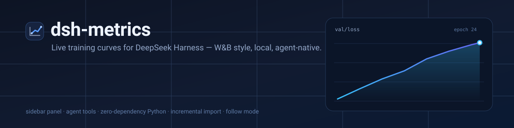

<p align="center">
  
</p>

<p align="center">
  <a href="LICENSE"></a>
  
  
  
</p>

<p align="center"><b>English</b> · <a href="README.zh-CN.md">简体中文</a></p>

**dsh-metrics** adds a W&B-style live training dashboard to the
[DeepSeek Harness](https://github.com/deepseek-ai/deepseek-harness) Web GUI.
It is a normal DSH plugin: one sidebar entry, a full-screen curves page, four agent
tools, and a zero-dependency Python logger for your training scripts.

No account, no cloud, no `wandb.init`, no build step. Curves are stored as plain
JSONL under `~/.dsh/metrics` and streamed to the page over the local Harness server.

```text
training loop ──► dsh_metrics.py ──► ~/.dsh/metrics/<project>/<run>/history.jsonl
                                             │
                        Harness Host ◄───────┘  (HTTP + agent tools)
                             │
                    Web GUI ▸ sidebar ▸ Metrics
```

## Features

- **Whole-run curves, not a rolling window.** Every chart spans the first to the
  latest step of the run; new points extend the same line.
- **Live by default.** The page polls every 3 seconds while open. Follow a log
  file and it keeps appending new epochs automatically.
- **Compare runs.** Multi-select runs, one color per run, EMA smoothing slider,
  log-scale Y axis, hover readout, and a latest-values table with configs.
- **Log from Python in three lines.** Standard library only; NaN/inf are skipped;
  every point is flushed so a crash does not lose the curve.
- **Agent-native.** `metrics_log`, `metrics_import`, `metrics_list`, and
  `metrics_get` let any DSH agent publish, import, inspect, and analyse runs.
- **Import what you already have.** CSV, TSV, JSONL, or a JSON array. Re-imports
  are incremental: only rows appended since the last read are added.
- **Local-first.** Data never leaves the machine. Runs are directories you can
  read, grep, back up, or delete.

## Requirements

| | |
|---|---|
| Harness | `dsh` with the **web** profile (DSH 0.2.x) |
| Browser | any modern Chromium/Firefox/Safari — the page uses the host theme |
| Python (optional) | 3.8+ for `dsh_metrics.py`; no third-party packages |
| Package manager | `pnpm`, used by `dsh plugin` |

## Installation

### From GitHub

```bash
dsh plugin --profile web add github:inkwindA/dsh-metrics
```

Or from a clone:

```bash
git clone https://github.com/inkwindA/dsh-metrics.git
dsh plugin --profile web add ./dsh-metrics
```

The plugin is linked into the active profile and applied live. **Refresh the Web
page once**; no Harness restart is required. A folded-line icon labelled
**Metrics / 指标** appears in the sidebar panel list.

> `dsh plugin` forwards to pnpm inside the profile, so the profile needs pnpm on
> `PATH`. Installing a plugin is the only step that needs it.

### Verify

```bash
curl -s http://127.0.0.1:3080/dsh-metrics/api/state
```

```json
{"version":"1.0.0","root":"/home/you/.dsh/metrics","runs":[]}
```

Then open the **Metrics** panel in the sidebar and log something with the quick
start below.

## Quick start

Download the Python logger from the running Harness (it is also in
[`python/dsh_metrics.py`](python/dsh_metrics.py)):

```bash
curl -fsSL http://127.0.0.1:3080/dsh-metrics/sdk/dsh_metrics.py -o dsh_metrics.py
```

```python
import dsh_metrics

run = dsh_metrics.init(
    project="mnist",
    name="baseline",
    config={"lr": 1e-3, "batch_size": 64},
    tags=["cnn"],
)

for epoch in range(1, 11):
    train_loss, train_acc = train_one_epoch(model)
    val_loss, val_acc = evaluate(model)
    run.log({
        "loss": train_loss,
        "acc": train_acc,
        "val_loss": val_loss,
        "val_acc": val_acc,
    }, step=epoch)

run.finish()
```

`run.log(loss=..., acc=..., step=...)` also works. Metric names may contain `/`
(`"train/loss"`, `"val/acc"`); without a `step` the logger increments from 0.

Each `init()` starts a new run. `resume=True` continues the latest unfinished run
with the same name. The store root is `$DSH_METRICS_DIR`, else
`$DSH_HOME/metrics`, else `~/.dsh/metrics`.

## The dashboard

Open **Metrics** in the sidebar:

| Area | What it does |
|---|---|
| Left column | Search, select, and delete runs, grouped by project. Live runs show `running`; finished ones show `finished`. |
| Charts | One SVG chart per metric. Hover for a crosshair readout; every selected run is overlaid in its own color. |
| Toolbar | Metric filter, EMA smoothing, log Y, Live polling (3 s), manual refresh. |
| Overview table | Latest value of every metric for each selected run, plus its config and step count. |
| Python SDK panel | Copy the snippet or download `dsh_metrics.py` straight from the page. |

The x axis always covers the **entire run**. `maxPoints` only controls how many
samples the browser receives (uniform downsampling); it never narrows the range.

## Agent tools

Any DSH agent in the same profile sees these tools automatically. They share the
same store as the page, so a tool call shows up on screen within one poll.

| Tool | Purpose |
|---|---|
| `metrics_log` | Append points to a run. Use it to publish results or turn numbers you computed into a chart. |
| `metrics_import` | Import CSV/TSV/JSONL/JSON logs. Re-import only appends new rows; `follow: true` tails a growing file. |
| `metrics_list` | List runs with latest/min/max values, step counts, and config. |
| `metrics_get` | Read one run's series (downsampled, 120 points by default) for analysis or anomaly checks. |

### Show one complete training task

```json
{
  "path": "runs/exp1/train.csv",
  "project": "detr",
  "run": "exp1",
  "follow": true,
  "intervalSeconds": 5,
  "idleSeconds": 900
}
```

`metrics_import` reads the file once, then the Host tails it every 5 seconds and
appends only new rows. The curve grows from the first epoch to the last without
redrawing. After 15 minutes without new rows the follower stops and marks the run
finished. Restarting DSH stops followers (data is intact); run the import again to
continue.

### One sentence for another agent

> Follow `runs/exp1/train.csv` into the metrics dashboard as project `detr` /
> run `exp1`, with the whole training curve updating as new epochs arrive.

More generally:

> Publish this training run's complete curve (every step/epoch, from the first to
> the last) to the metrics dashboard — use `run.log()` in the loop, or
> `metrics_import` with `follow: true` for a log file; project=`xxx`, run=`yyy`.

The tools' descriptions already explain their parameters, so one sentence is
enough. For agents that cannot call DSH tools, point them at the HTTP API or the
JSONL format below.

## HTTP API

The page and tools are thin clients over the same local API. It binds to the
Harness listener (`127.0.0.1:3080` by default).

| Method | Path | Body / query | Description |
|---|---|---|---|
| `GET` | `/dsh-metrics/api/state` | — | Runs with metric summaries |
| `GET` | `/dsh-metrics/api/run` | `?project=&run=` | One run with downsampled series |
| `POST` | `/dsh-metrics/api/log` | `{project, run, points, config?, tags?}` | Append points |
| `POST` | `/dsh-metrics/api/delete` | `{project, run}` | Delete a run directory |
| `GET` | `/dsh-metrics/sdk/dsh_metrics.py` | — | Download the Python logger |

> The API has no extra token check; it relies on the listener being loopback-only.
> If you expose the Harness to a network, put authentication in front of it.

## Data format

```
~/.dsh/metrics/<project>/<run>/run.json       # name, config, tags, status, import cursor
~/.dsh/metrics/<project>/<run>/history.jsonl  # append-only points
```

Each history line:

```json
{"t": 1792564685211, "step": 120, "metrics": {"loss": 0.42, "acc": 0.91}}
```

Flat lines such as `{"step": 120, "loss": 0.42}` are accepted too, so you can
produce the file from any language. Appends use `O_APPEND`; the Python logger and
the Host can write concurrently.

## Configuration

Override the row in your profile's `cordis.patch.yml`:

```yaml
- id: dsh-metrics
  name: "@inkwinda/dsh-metrics"
  config:
    maxPoints: 1500      # samples returned per metric (uniform downsampling)
    dataDir: /absolute/path/to/metrics
```

The data directory can also come from `DSH_METRICS_DIR`.

## Development

There is no build step. The Host half is plain ESM; the Client half is a plain
`client.js` loaded by the Harness module loader, and the Python file is standard
library only.

```bash
git clone https://github.com/inkwindA/dsh-metrics.git
cd dsh-metrics
node --check index.js
node --check client.js
python3 -m py_compile python/dsh_metrics.py
dsh plugin --profile web add "$PWD"
```

Layout:

```
index.js            Host plugin: tools, follower, HTTP route
store.js            run directories, caching, downsampling, ingest cursor
import.js           CSV/TSV/JSONL/JSON parsing
http.js             /dsh-metrics API
client.js           sidebar icon + dashboard page (React via the host loader)
python/dsh_metrics.py   zero-dependency logger
examples/           simulated training loop + sample CSV
docs/banner.svg     README artwork
```

## Compatibility & notes

- Targets the DSH **web** profile and the 0.2.x plugin API.
- The page uses a render error boundary: a bug shows an error card instead of a
  blank panel.
- The dashboard keeps demo runs only if you create them; it never fabricates data.
- Deleting a run is a two-click confirmation in the UI and removes the directory.

## License

[MIT](LICENSE) © 2026 inkwindA
